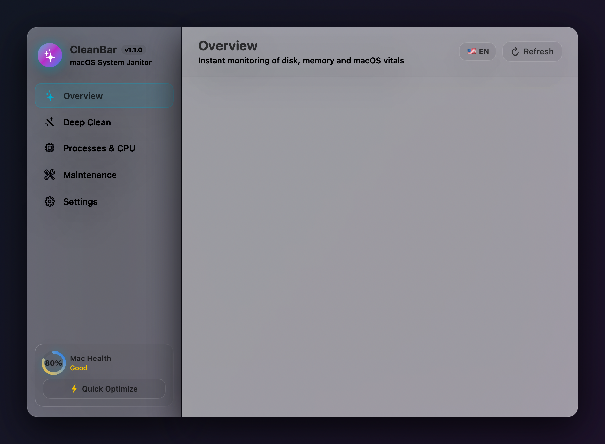
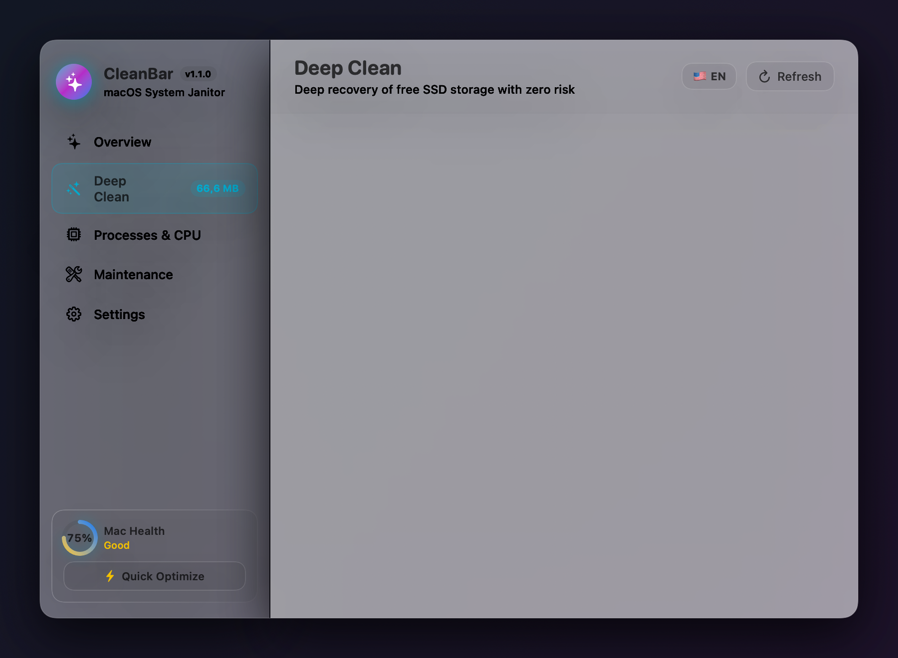
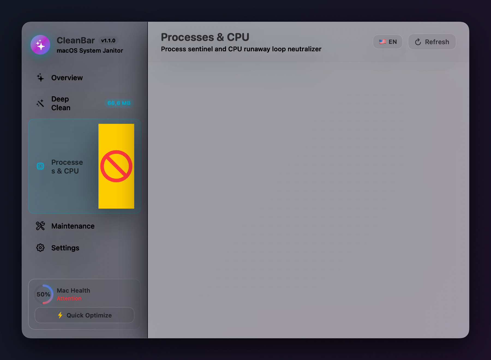

<div align="center">

# 🍏 CleanBar

### *The Native, Zero-Bloat macOS App & Menu Bar Companion*
### *O Aplicativo Nativo e Sem Bloatware para macOS & Barra de Menus*

**Reclaim gigabytes of hidden storage, eliminate runaway CPU hogs, and keep your Mac running at peak speed.**  
*Recupere gigabytes de armazenamento oculto, elimine travamentos de CPU e mantenha seu Mac na velocidade máxima.*

[](https://github.com/JulioJCLF/CleanBar/releases/latest)
[](https://github.com/JulioJCLF/CleanBar)
[](https://github.com/JulioJCLF/CleanBar/releases/latest)
[](https://swift.org)
[](LICENSE)

<br/>

[🇺🇸 English](#-english) • [🇧🇷 Português](#-português) • [Download v1.1.0](https://github.com/JulioJCLF/CleanBar/releases/latest)

<br/>


<br/>

</div>

---

# 🇺🇸 English

## 💡 The Problem with Modern Mac Cleaners

Over time, everyday macOS usage silently clutters your storage:
- **Application & Browser Caches** (`~/Library/Caches`) quietly swell into tens of gigabytes from web browsers, streaming apps, and daily tools.
- **Residual Installers & Leftover DMGs** (`.dmg`, `.pkg`) remain forgotten in your Downloads folder after installing apps.
- **Developer Cruft & Build Artifacts** (`Xcode DerivedData`) silently consume dozens of gigabytes on developer machines.
- **Diagnostic Reports & System Logs** (`~/Library/Logs`) pile up gigabytes of error telemetry and diagnostic dumps.
- **Orphaned Daemons & Runaway Background Tasks** peg CPU cores, causing system heat and draining battery life.

Most utilities designed to solve this are either **heavy Electron applications** (running an entire Chromium browser in background consuming 300+ MB of RAM) or lock basic features behind **expensive annual subscriptions**.

### 🌟 The CleanBar Philosophy: Pure, Native & Featherlight
**CleanBar** is built 100% in **Swift 6.4 + SwiftUI + AppKit**:
- **Dual Experience**: Dedicated full-featured desktop window app + lightweight instant menu bar hub.
- **Bilingual Interface**: Native support for English 🇺🇸 and Portuguese 🇧🇷 with instant 1-click switching.
- **Butter-Smooth Animations**: Fluid 60/120Hz ProMotion spring animations, animated circular gauge rings, and continuous status feedback.
- **Tiny footprint**: Less than **4.8 MB** Universal 2 binary (Apple Silicon M1/M2/M3/M4 + Intel x86_64).
- **Zero background overhead**: **0.0% CPU** at idle and **< 35 MB of RAM** (~32 MB resident).
- **Authentic macOS Design**: Apple-grade Frosted Glass (`.ultraThinMaterial`) matching macOS Sequoia / Sonoma aesthetics.
- **100% Private & Offline**: Zero analytics, zero tracking, zero internet calls.

---

## 📸 Core Modules

<div align="center">

| 📊 1. Overview & Vitals | 🧼 2. Deep System Cleaning | ⚡ 3. CPU Sentinel & Process Killer |
|:---:|:---:|:---:|
|  |  |  |
| Real-time SSD & RAM monitors with Mac Health Score & 1-click optimization | 5-category granular purge for app caches, installers, logs, trash & Xcode | Real-time CPU monitor with instant kill switch for runaway loops |

</div>

---

## ✨ Features at a Glance

### 1. 📊 Real-Time Storage & System Vitals
- **Zero-Lag SSD Gauge**: Reads disk metrics directly from Darwin POSIX syscalls (`statfs`) in microseconds—never freezes your menu bar or waits on slow APFS background daemons.
- **Kernel-Level RAM Monitor**: Real-time memory consumption (Active, Wired, Compressed vs. Free) queried directly from Mach kernel statistics (`host_statistics64`) with 0% CPU overhead.
- **Mac Health Score**: Intelligent rating (0-100%) evaluating disk saturation, memory pressure, and CPU runaway processes.
- **System Telemetry**: Displays system uptime, processor architecture (Apple Silicon / Intel), and macOS version.

### 2. 🧼 Deep System Cleaning
- **Application & Browser Caches**: Deep-scans `~/Library/Caches` to safely remove cached data from Chrome, Safari, Spotify, Slack, Discord, and third-party apps.
- **Residual Installers & Images**: Detects and purges forgotten `.dmg`, `.pkg`, and `.iso` installers sitting in `~/Downloads`.
- **System Logs & Diagnostic Reports**: Removes old crash logs, telemetry dumps, and stale diagnostic traces from `~/Library/Logs`.
- **Trash & Session Temp**: Safely purges temporary session files and empties the macOS Trash via Finder automation.
- **Developer Cruft (Xcode)**: Detects and purges `DerivedData` build artifacts without affecting source projects.
- **Granular Control**: Every category can be reviewed and toggled before cleaning, with a live counter of recoverable space.

### 3. ⚡ Process Sentinel & CPU Tamer (Anti-Freeze)
- **Top CPU Consumers**: Real-time telemetry refreshed on demand or on tab focus with negligible system impact.
- **Runaway Loop Warning**: Automatically highlights background daemons or unresponsive apps consuming >25% CPU with a prominent red pulsing alert card.
- **One-Click Process Killer**: Terminate frozen or rogue tasks instantly, backed by safety guardrails that protect critical macOS system processes (`WindowServer`, `launchd`).

### 4. 🛠️ Quick Maintenance Tools
- **Flush DNS Cache**: Instant execution of `dscacheutil -flushcache` and `killall -HUP mDNSResponder` to resolve network slowdowns.
- **Empty Trash**: Reliable Finder-integrated trash purging with confirmation and sound.
- **Quick Caches**: Fast purge of browser and messaging caches.
- **1-Click Full Optimization**: Runs all quick maintenance routines together.

---

## ⚡ Comparison

| Feature | CleanBar 🍏 | CleanMyMac | Electron Cleaners |
| :--- | :---: | :---: | :---: |
| **Engine** | **Native Swift 6.4 + SwiftUI** | Objective-C / Swift | Electron / Web Technologies |
| **Bilingual** | **English & Portuguese** | Multilingual | Varies |
| **App Size** | **< 4.8 MB (Universal)** | ~150 MB | 120–250 MB |
| **Idle Memory (RAM)** | **< 35 MB** | 120–200 MB | 300–600 MB |
| **Idle CPU Usage** | **0.0%** | Background Daemon | 1.0–4.0% |
| **Price** | **100% Free & Open Source** | $39.95 / year | Subscription / Freemium |
| **Design** | **Desktop Window + Menu Bar Hub** | Custom Window | Web HTML/CSS |
| **Telemetry / Tracking** | **None (100% Offline)** | Extensive | Analytics Trackers |

---

## 📥 Installation

### Option 1: Direct Download (Pre-built Universal Binary)
1. Download `CleanBar-v1.1.0-macOS-Universal.zip` from the **[Latest Release](https://github.com/JulioJCLF/CleanBar/releases/latest)**.
2. Unzip and drag `CleanBar.app` into your **Applications** folder (`/Applications`).
3. Launch `CleanBar`—the full standalone application window and the menu bar companion (`✨`) will open!

> [!TIP]
> **First Launch on macOS**: As an open-source project without a paid Apple Developer certificate, on the first launch: **Right-click** `CleanBar.app` → select **Open** → click **Open** to confirm.

### Option 2: Launch on Startup (Recommended)
1. Open **System Settings** on your Mac.
2. Go to **General** > **Login Items**.
3. Under *Open at Login*, click `+` and add `/Applications/CleanBar.app`.

---

## 🛠️ Building from Source

```bash
# Clone the repository
git clone https://github.com/JulioJCLF/CleanBar.git
cd CleanBar

# Build Universal 2 binary (Apple Silicon + Intel)
swift build -c release --triple arm64-apple-macosx
cp .build/out/Products/Release/CleanBar /tmp/CleanBar_arm64

swift build -c release --triple x86_64-apple-macosx
cp .build/out/Products/Release/CleanBar /tmp/CleanBar_x86_64

# Package into Universal App
lipo -create -output CleanBar.app/Contents/MacOS/CleanBar /tmp/CleanBar_arm64 /tmp/CleanBar_x86_64
codesign --force --deep -s - -r '=designated => identifier "com.jclf.cleanbar"' CleanBar.app
```

---

<br/>

# 🇧🇷 Português

## 💡 O Problema dos Limpadores Atuais do Mac

Com o uso diário, o macOS acumula silenciosamente gigabytes de arquivos desnecessários:
- **Caches de Aplicativos e Navegadores** (`~/Library/Caches`) crescem silenciosamente para dezenas de gigabytes com dados de navegadores, mensageiros e reprodutores de mídia.
- **Instaladores Residuais e DMGs Esquecidos** (`.dmg`, `.pkg`) ficam ocupando espaço na pasta Downloads após a instalação dos programas.
- **Resíduos de Compilação de Desenvolvedores** (`Xcode DerivedData`) devoram dezenas de gigabytes sem aviso em máquinas de desenvolvimento.
- **Logs e Relatórios de Diagnóstico** (`~/Library/Logs`) acumulam dumps de falhas e arquivos de telemetria desnecessários.
- **Processos Zumbis e Daemons em Loop Infinito** sobrecarregam a CPU, esquentam o computador e reduzem a duração da bateria.

A maioria dos programas criados para resolver isso são **aplicativos pesados em Electron** (que rodam um navegador Chromium inteiro em segundo plano consumindo mais de 300 MB de RAM) ou cobram **assinaturas anuais caras**.

### 🌟 A Filosofia CleanBar: Puro, Nativo e Ultraleve
O **CleanBar** é desenvolvido 100% em **Swift 6.4 + SwiftUI + AppKit**:
- **Experiência Dupla**: Aplicativo completo em janela para desktop + hub instantâneo na barra de menus.
- **Totalmente Bilíngue**: Suporte nativo para Português 🇧🇷 e Inglês 🇺🇸 com alternância instantânea nas Configurações ou cabeçalho.
- **Animações Fluidas**: Física elástica em 60/120Hz (ProMotion), anéis medidores animados e feedback tátil háptico (`NSHapticFeedbackManager`).
- **Tamanho Mínimo**: Binário Universal 2 com menos de **4.8 MB** (compatível nativamente com Apple Silicon M1/M2/M3/M4 e Macs Intel).
- **Consumo Zero em Repouso**: **0.0% de CPU** em repouso e **menos de 35 MB de memória RAM** (~32 MB residentes).
- **Design Autêntico macOS**: Vidro fosco translúcido (*Glassmorphism*) com materiais nativos da Apple (`.ultraThinMaterial`).
- **100% Privado e Offline**: Sem rastreadores, sem telemetria, sem contas e sem necessidade de conexão com a internet.

---

## ✨ Recursos Principais

### 1. 📊 Visão Geral e Saúde do Mac (Dashboard)
- **Medidor de Disco sem Travamentos**: Leituras instantâneas direto do kernel (`statfs`) em microssegundos—sem congelar a barra de menus nem depender de daemons lentos do APFS.
- **Monitor de Memória RAM a Nível de Kernel**: Divisão detalhada de consumo (Ativa, Com Fio, Comprimida e Livre) obtida via estatísticas do Mach kernel (`host_statistics64`).
- **Índice de Saúde do Mac**: Pontuação inteligente (0 a 100%) que avalia simultaneamente espaço livre em disco, pressão de memória RAM e processos sobrecarregando a CPU.
- **Telemetria do Sistema**: Exibe tempo de atividade contínuo (Uptime), processador (Apple Silicon / Intel) e versão do macOS.

### 2. 🧼 Limpeza Profunda (*Deep Clean*)
- **Caches de Aplicativos & Web**: Varre `~/Library/Caches` para remover caches do Chrome, Safari, Spotify, Slack, Discord e apps de terceiros.
- **Instaladores Residuais (.dmg, .pkg, .iso)**: Localiza e remove imagens de disco esquecidas na pasta `~/Downloads`.
- **Logs e Relatórios de Diagnóstico**: Limpa relatórios antigos de erros e arquivos de log em `~/Library/Logs`.
- **Lixeira do macOS e Temporários**: Esvazia a lixeira do usuário com segurança através do Finder e remove temporários de sessão.
- **Caches de Desenvolvimento (Xcode)**: Detecta e remove com segurança o diretório `DerivedData` do Xcode sem afetar projetos originais.
- **Controle Granular**: Visualize o espaço antes de limpar e selecione/desmarque qualquer categoria individualmente.

### 3. ⚡ Sentinela de Processos e Anti-Travamento (CPU Tamer)
- **Maiores Consumidores de CPU**: Monitoramento em tempo real com baixo impacto no sistema.
- **Alerta de Processo em Loop**: Identifica automaticamente aplicativos ou daemons em segundo plano consumindo mais de 25% de CPU com um cartão vermelho pulsante.
- **Finalizador de Tarefas com 1 Clique**: Encerre processos travados imediatamente, com proteções de segurança que impedem o encerramento acidental de processos críticos do macOS (`WindowServer`, `launchd`).

### 4. 🛠️ Ferramentas Rápidas de Manutenção
- **Renovar Cache de DNS**: Executa `dscacheutil -flushcache` e reinicia o `mDNSResponder` para resolver instabilidades e lentidões de rede.
- **Esvaziar Lixeira**: Integração direta com o Finder para esvaziamento seguro com som nativo do sistema.
- **Limpeza Expressa de Caches**: Limpa os caches dos principais navegadores e mensageiros com um toque.
- **Otimização Completa com 1 Clique**: Executa todas as ações de manutenção e atualiza as métricas de forma sincronizada.

---

## 📥 Como Baixar e Instalar

### Opção 1: Download Direto (Binário Universal Pré-compilado)
1. Baixe o arquivo `CleanBar-v1.1.0-macOS-Universal.zip` na aba **[Releases](https://github.com/JulioJCLF/CleanBar/releases/latest)**.
2. Descompacte o arquivo e arraste o **CleanBar.app** para a sua pasta **Aplicativos** (`/Applications`).
3. Abra o CleanBar—a janela principal do app e o ícone com estrelas (`✨`) na barra de menus abrirão imediatamente!

> [!TIP]
> **Primeira Inicialização no Mac**: Por ser um projeto de código aberto independente, no primeiro acesso: clique com o **botão direito** no `CleanBar.app` → selecione **Abrir** → confirme clicando em **Abrir**.

### Opção 2: Iniciar com o Sistema (Recomendado)
1. Abra os **Ajustes do Sistema** do seu Mac.
2. Vá em **Geral** > **Itens de Início**.
3. Na seção *Abrir no Início*, clique em `+` e adicione `/Applications/CleanBar.app`.

---

## 📄 Licença / License

Distribuído sob a licença **MIT License**. Veja o arquivo [LICENSE](LICENSE) para mais detalhes.

<br/>

<div align="center">
  <sub>Crafted with Swift by <a href="https://github.com/JulioJCLF">Julio Lopes</a>.</sub>
</div>
