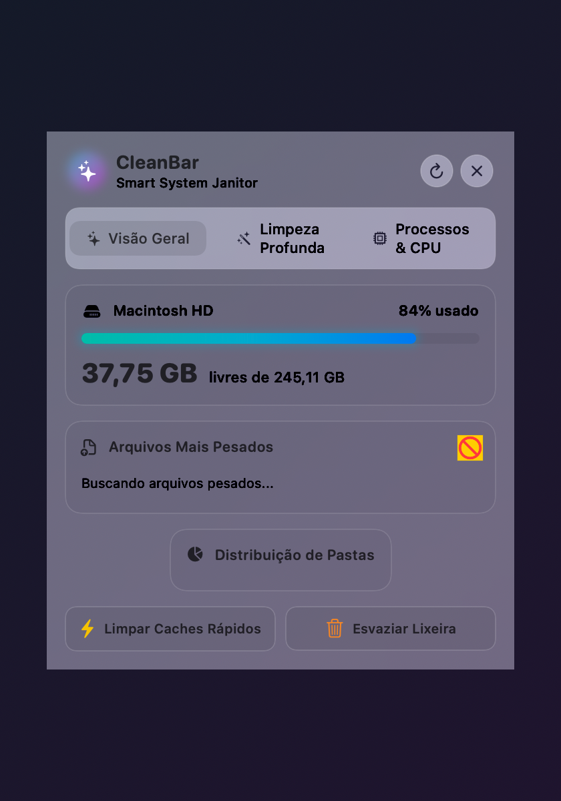
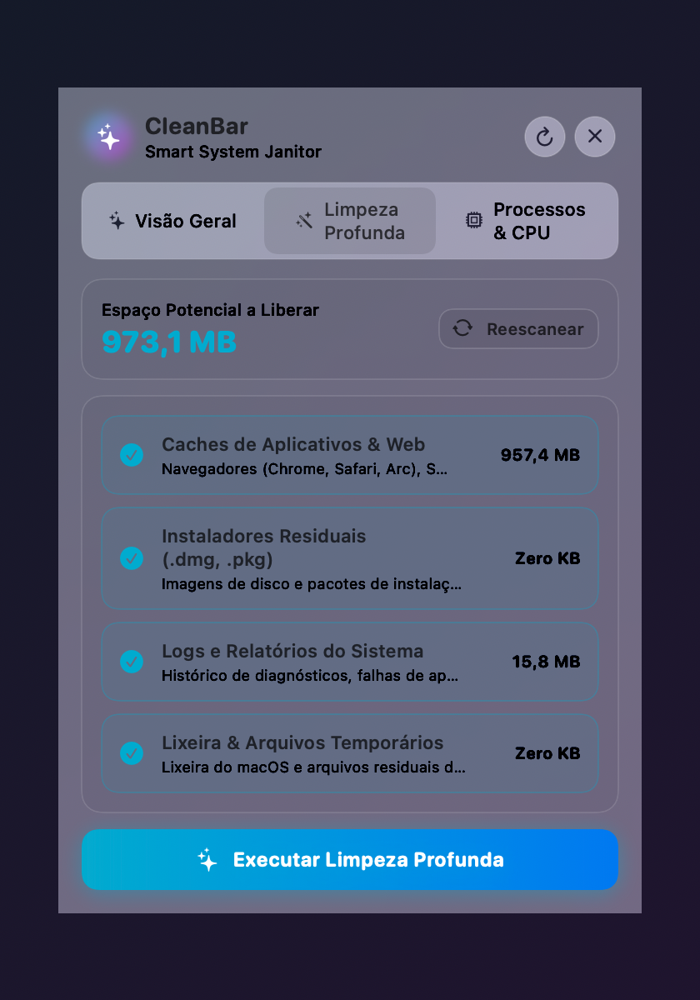
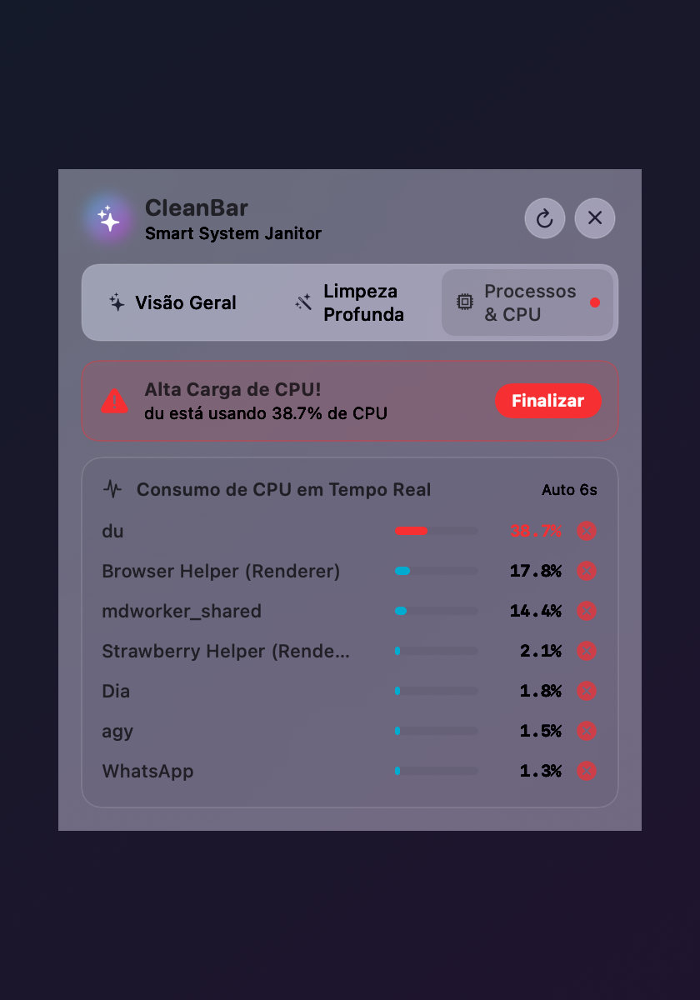

<div align="center">

# 🍏 CleanBar

### *The Native, Zero-Bloat Menu Bar Cleaner & System Monitor for macOS*
**Reclaim gigabytes of hidden storage, eliminate runaway CPU hogs, and keep your Mac running at peak speed.**

[](https://github.com/JulioJCLF/CleanBar/releases/latest)
[](https://github.com/JulioJCLF/CleanBar)
[](https://github.com/JulioJCLF/CleanBar/releases/latest)
[](https://swift.org)
[](LICENSE)

<br/>


[](https://github.com/JulioJCLF/CleanBar/releases/latest)
[](https://github.com/JulioJCLF/CleanBar/stargazers)

<br/>


<br/>
<br/>

**[Download Latest Release (macOS Universal)](https://github.com/JulioJCLF/CleanBar/releases/latest)**

</div>

---

## 💡 The Problem with Modern Mac Cleaners

Over time, everyday macOS usage silently clutters your storage:
- **Application & Browser Caches** (`~/Library/Caches`) quietly swell into tens of gigabytes from web browsers, streaming apps, and daily tools.
- **Residual Installers & Leftover DMGs** (`.dmg`, `.pkg`) remain forgotten in your Downloads folder after installing apps.
- **Diagnostic Reports & System Logs** (`~/Library/Logs`) pile up gigabytes of error telemetry and diagnostic dumps.
- **Orphaned Daemons & Runaway Background Tasks** peg CPU cores, causing system heat and draining battery life.

Most utilities designed to solve this are either **heavy Electron applications** (running an entire Chromium browser in background consuming 300+ MB of RAM) or lock basic features behind **expensive annual subscriptions**.

### 🌟 The CleanBar Philosophy: Pure, Native & Featherlight
**CleanBar** is built 100% in **Swift 6 + SwiftUI + AppKit**:
- **Tiny footprint**: Less than **500 KB** total download size.
- **Zero background overhead**: **0.0% CPU** at idle and **< 45 MB of RAM**.
- **Authentic macOS Design**: Beautiful, responsive **Glassmorphism** popover using Apple's `.ultraThinMaterial`.
- **100% Private & Offline**: Zero analytics, zero tracking, zero internet calls.

---

## 📸 Core Modules

<div align="center">

| 📊 1. Overview & Heavy Files | 🧼 2. Deep System Cleaning | ⚡ 3. CPU Sentinel & Process Killer |
|:---:|:---:|:---:|
|  |  |  |
| Real-time SSD gauge, heavy files finder & storage folder breakdown | 4-category granular purge for app caches, installers, logs & trash | Real-time CPU monitor with instant kill switch for runaway loops |

</div>

---

## ✨ Features at a Glance

### 1. 📊 Real-Time Storage & Heavy File Manager
- **Zero-Lag SSD Gauge**: Reads disk metrics directly from Darwin POSIX syscalls (`statfs`) in microseconds—never freezes your menu bar or waits on slow APFS background daemons.
- **Heavy Files Finder**: Automatically surfaces your largest files (>40 MB) across Downloads, Desktop, Movies, and Documents with 1-click Reveal in Finder or Trash.
- **Folder Storage Breakdown**: Visual overview of how much space Downloads, Application Caches, Documents, and Trash are consuming.
- **Quick Maintenance**: One-tap shortcuts for quick app cache purge and emptying macOS Trash.

### 2. 🧼 Deep System Cleaning
- **Application & Browser Caches**: Deep-scans `~/Library/Caches` to safely remove cached data from Chrome, Safari, Spotify, Slack, Discord, and third-party apps.
- **Residual Installers & Images**: Detects and purges forgotten `.dmg`, `.pkg`, and `.iso` installers sitting in `~/Downloads`.
- **System Logs & Diagnostic Reports**: Removes old crash logs, telemetry dumps, and stale diagnostic traces from `~/Library/Logs`.
- **Trash & Session Temp**: Safely purges temporary session files and empties the macOS Trash.
- **Granular Control**: Every category can be reviewed and toggled before cleaning, with a live counter of recoverable space.

### 3. ⚡ Process Sentinel & CPU Tamer (Anti-Freeze)
- **Top 7 CPU Consumers**: Real-time telemetry refreshed every 6 seconds with negligible system impact.
- **Runaway Loop Warning**: Automatically highlights background daemons or unresponsive apps consuming >25% CPU with a prominent red alert card.
- **One-Click Process Killer**: Terminate frozen or rogue tasks instantly, backed by safety guardrails that protect critical macOS system processes (`WindowServer`, `launchd`).

---

## ⚡ Comparison

| Feature | CleanBar 🍏 | CleanMyMac | Electron Cleaners |
| :--- | :---: | :---: | :---: |
| **Engine** | **Native Swift 6 + SwiftUI** | Objective-C / Swift | Electron / Web Technologies |
| **App Size** | **471 KB** | ~150 MB | 120–250 MB |
| **Idle Memory (RAM)** | **< 45 MB** | 120–200 MB | 300–600 MB |
| **Idle CPU Usage** | **0.0%** | Background Daemon | 1.0–4.0% |
| **Price** | **100% Free & Open Source** | $39.95 / year | Subscription / Freemium |
| **Design** | **Native Frosted Glass Popover** | Custom Window | Web HTML/CSS |
| **Telemetry / Tracking** | **None (100% Offline)** | Extensive | Analytics Trackers |

---

## 📥 Installation

### Option 1: Direct Download (Pre-built Universal Binary)
1. Download `CleanBar-v1.0.0-macOS-Universal.zip` from the **[Latest Release](https://github.com/JulioJCLF/CleanBar/releases/latest)**.
2. Unzip and drag `CleanBar.app` into your **Applications** folder (`/Applications`).
3. Launch `CleanBar`—the sparkles icon (`✨`) will appear in your top menu bar!

> [!TIP]
> **First Launch on macOS**: As an open-source project without a paid Apple Developer certificate, on the first launch: **Right-click** `CleanBar.app` → select **Open** → click **Open** to confirm.

### Option 2: Launch on Startup (Recommended)
1. Open **System Settings** on your Mac.
2. Go to **General** > **Login Items**.
3. Under *Open at Login*, click `+` and add `/Applications/CleanBar.app`.

---

## 🛠️ Building from Source

CleanBar compiles with zero third-party package dependencies.

### Requirements
- macOS 13.0 (Ventura) or newer
- Xcode Command Line Tools (`xcode-select --install`)

```bash
# Clone the repository
git clone https://github.com/JulioJCLF/CleanBar.git
cd CleanBar

# Build Universal 2 binary (Apple Silicon + Intel)
swift build -c release --arch arm64
swift build -c release --arch x86_64

# Package into Universal App
lipo -create -output CleanBar.app/Contents/MacOS/CleanBar \
  .build/arm64-apple-macosx/release/CleanBar \
  .build/x86_64-apple-macosx/release/CleanBar
```

---

## 📄 License

Distributed under the **MIT License**. See [LICENSE](LICENSE) for details.

<br/>

<div align="center">
  <sub>Crafted with Swift by <a href="https://github.com/JulioJCLF">Julio Lopes</a>.</sub>
</div>
