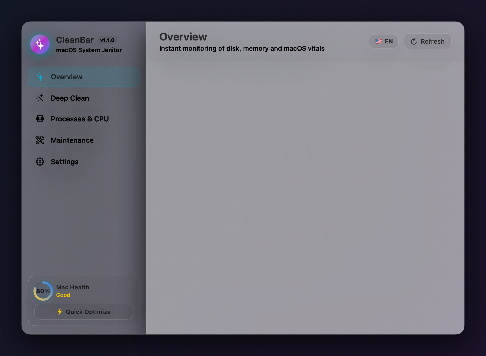
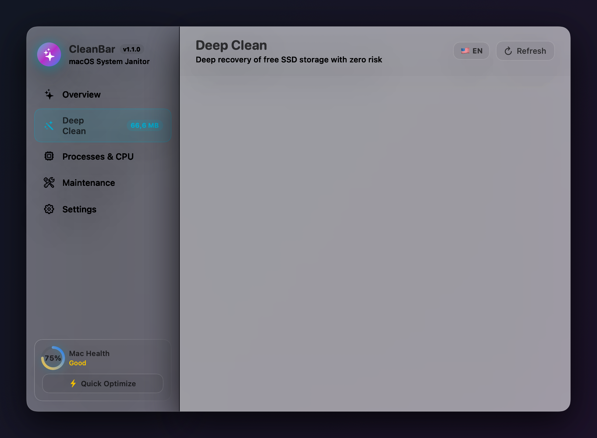
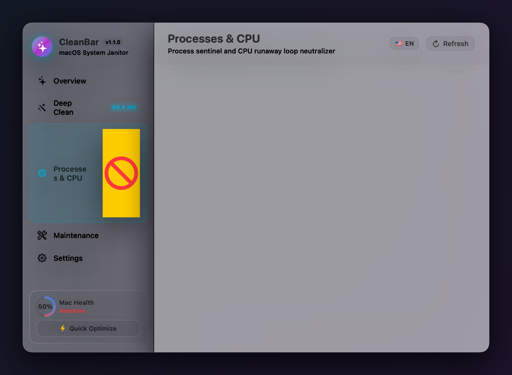

<div align="center">

# 🍏 CleanBar

### *O Aplicativo Nativo e Sem Bloatware para macOS & Barra de Menus*

**Recupere gigabytes de armazenamento oculto, elimine travamentos de CPU e mantenha seu Mac na velocidade máxima.**

[](https://github.com/JulioJCLF/CleanBar/releases/latest)
[](https://github.com/JulioJCLF/CleanBar)
[](https://github.com/JulioJCLF/CleanBar/releases/latest)
[](https://swift.org)
[](LICENSE)

<br/>

[🇺🇸 English Version (README.md)](README.md) • [Download v1.1.0](https://github.com/JulioJCLF/CleanBar/releases/latest)

<br/>


<br/>

</div>

---

## 💡 O Problema dos Limpadores Atuais do Mac

Com o uso diário, o macOS acumula silenciosamente gigabytes de arquivos desnecessários:
- **Caches de Aplicativos e Navegadores** (`~/Library/Caches`) crescem silenciosamente para dezenas de gigabytes com dados de navegadores, mensageiros e reprodutores de mídia.
- **Instaladores Residuais e DMGs Esquecidos** (`.dmg`, `.pkg`) ficam ocupando espaço na pasta Downloads após a instalação dos programas.
- **Resíduos de Compilação de Desenvolvedores** (`Xcode DerivedData`) devoram dezenas de gigabytes sem aviso em máquinas de desenvolvimento.
- **Logs e Relatórios de Diagnóstico** (`~/Library/Logs`) acumulam dumps de falhas e arquivos de telemetria desnecessários.
- **Processos Zumbis e Daemons em Loop Infinito** sobrecarregam a CPU, esquentam o computador e reduzem a duração da bateria.

A maioria dos programas criados para resolver isso são **aplicativos pesados em Electron** (que rodam um navegador Chromium inteiro em segundo plano consumindo mais de 300 MB de RAM) ou cobram **assinaturas anuais caras**.

### 🌟 A Filosofia CleanBar: Puro, Nativo e Ultraleve
O **CleanBar** é desenvolvido 100% em **Swift 6.4 + SwiftUI + AppKit**:
- **Experiência Dupla**: Aplicativo completo em janela para desktop + hub instantâneo na barra de menus.
- **Totalmente Bilíngue**: Suporte nativo para Português 🇧🇷 e Inglês 🇺🇸 com alternância instantânea nas Configurações ou cabeçalho.
- **Animações Fluidas**: Física elástica em 60/120Hz (ProMotion), anéis medidores animados e feedback tátil háptico (`NSHapticFeedbackManager`).
- **Tamanho Mínimo**: Binário Universal 2 com menos de **4.8 MB** (compatível nativamente com Apple Silicon M1/M2/M3/M4 e Macs Intel).
- **Consumo Zero em Repouso**: **0.0% de CPU** em repouso e **menos de 40 MB de memória RAM**.
- **Design Autêntico macOS**: Vidro fosco translúcido (*Glassmorphism*) com materiais nativos da Apple (`.ultraThinMaterial`).
- **100% Privado e Offline**: Sem rastreadores, sem telemetria, sem contas e sem necessidade de conexão com a internet.

---

## 📸 Módulos Principais

<div align="center">

| 📊 1. Visão Geral & Saúde | 🧼 2. Limpeza Profunda | ⚡ 3. Sentinela de Processos |
|:---:|:---:|:---:|
|  |  |  |
| Monitores de SSD e RAM em tempo real com Índice de Saúde e otimização em 1 clique | Purga granular em 5 categorias para caches, instaladores, logs, lixeira e Xcode | Monitor de CPU com botão de encerramento para processos travados |

</div>

---

## ✨ Recursos Principais

### 1. 📊 Visão Geral e Saúde do Mac (Dashboard)
- **Medidor de Disco sem Travamentos**: Leituras instantâneas direto do kernel (`statfs`) em microssegundos—sem congelar a barra de menus nem depender de daemons lentos do APFS.
- **Monitor de Memória RAM a Nível de Kernel**: Divisão detalhada de consumo (Ativa, Com Fio, Comprimida e Livre) obtida via estatísticas do Mach kernel (`host_statistics64`).
- **Índice de Saúde do Mac**: Pontuação inteligente (0 a 100%) que avalia simultaneamente espaço livre em disco, pressão de memória RAM e processos sobrecarregando a CPU.
- **Telemetria do Sistema**: Exibe tempo de atividade contínuo (Uptime), processador (Apple Silicon / Intel) e versão do macOS.

### 2. 🧼 Limpeza Profunda (*Deep Clean*)
- **Caches de Aplicativos & Web**: Varre `~/Library/Caches` para remover caches do Chrome, Safari, Spotify, Slack, Discord e apps de terceiros.
- **Instaladores Residuais (.dmg, .pkg, .iso)**: Localiza e remove imagens de disco esquecidas na pasta `~/Downloads`.
- **Logs e Relatórios de Diagnóstico**: Limpa relatórios antigos de erros e arquivos de log em `~/Library/Logs`.
- **Lixeira do macOS e Temporários**: Esvazia a lixeira do usuário com segurança através do Finder e remove temporários de sessão.
- **Caches de Desenvolvimento (Xcode)**: Detecta e remove com segurança o diretório `DerivedData` do Xcode sem afetar projetos originais.
- **Controle Granular**: Visualize o espaço antes de limpar e selecione/desmarque qualquer categoria individualmente.

### 3. ⚡ Sentinela de Processos e Anti-Travamento (CPU Tamer)
- **Maiores Consumidores de CPU**: Monitoramento em tempo real com baixo impacto no sistema.
- **Alerta de Processo em Loop**: Identifica automaticamente aplicativos ou daemons em segundo plano consumindo mais de 25% de CPU com um cartão vermelho pulsante.
- **Finalizador de Tarefas com 1 Clique**: Encerre processos travados imediatamente, com proteções de segurança que impedem o encerramento acidental de processos críticos do macOS (`WindowServer`, `launchd`).

### 4. 🛠️ Ferramentas Rápidas de Manutenção
- **Renovar Cache de DNS**: Executa `dscacheutil -flushcache` e reinicia o `mDNSResponder` para resolver instabilidades e lentidões de rede.
- **Esvaziar Lixeira**: Integração direta com o Finder para esvaziamento seguro com som nativo do sistema.
- **Limpeza Expressa de Caches**: Limpa os caches dos principais navegadores e mensageiros com um toque.
- **Otimização Completa com 1 Clique**: Executa todas as ações de manutenção e atualiza as métricas de forma sincronizada.

---

## ⚡ Comparativo

| Recurso | CleanBar 🍏 | CleanMyMac | Limpadores em Electron |
| :--- | :---: | :---: | :---: |
| **Engine** | **Swift 6.4 + SwiftUI Nativo** | Objective-C / Swift | Electron / Tecnologias Web |
| **Bilíngue** | **Inglês e Português** | Multilíngue | Varia |
| **Tamanho do App** | **< 4.8 MB (Universal)** | ~150 MB | 120–250 MB |
| **RAM em Repouso** | **< 40 MB** | 120–200 MB | 300–600 MB |
| **CPU em Repouso** | **0.0%** | Daemon em segundo plano | 1.0–4.0% |
| **Preço** | **100% Grátis e Código Aberto** | R$ 180+ / ano | Assinatura / Freemium |
| **Design** | **Janela Desktop + Barra de Menus** | Janela Customizada | HTML/CSS Web |
| **Telemetria / Rastreio** | **Nenhum (100% Offline)** | Extensiva | Rastreadores Analíticos |

---

## 📥 Como Baixar e Instalar

### Opção 1: Download Direto (Binário Universal Pré-compilado)
1. Baixe o arquivo `CleanBar-v1.1.0-macOS-Universal.zip` na aba **[Releases](https://github.com/JulioJCLF/CleanBar/releases/latest)**.
2. Descompacte o arquivo e arraste o **CleanBar.app** para a sua pasta **Aplicativos** (`/Applications`).
3. Abra o CleanBar—a janela principal do app e o ícone com estrelas (`✨`) na barra de menus abrirão imediatamente!

> [!TIP]
> **Primeira Inicialização no Mac**: Por ser um projeto de código aberto independente, no primeiro acesso: clique com o **botão direito** no `CleanBar.app` → selecione **Abrir** → confirme clicando em **Abrir**.

### Opção 2: Iniciar com o Sistema (Recomendado)
1. Abra os **Ajustes do Sistema** do seu Mac.
2. Vá em **Geral** > **Itens de Início**.
3. Na seção *Abrir no Início*, clique em `+` e adicione `/Applications/CleanBar.app`.

---

## 🛠️ Compilando a partir do Código Fonte

```bash
# Clonar o repositório
git clone https://github.com/JulioJCLF/CleanBar.git
cd CleanBar

# Compilar binário Universal 2 (Apple Silicon + Intel)
swift build -c release --triple arm64-apple-macosx
cp .build/out/Products/Release/CleanBar /tmp/CleanBar_arm64

swift build -c release --triple x86_64-apple-macosx
cp .build/out/Products/Release/CleanBar /tmp/CleanBar_x86_64

# Empacotar no Aplicativo Universal
lipo -create -output CleanBar.app/Contents/MacOS/CleanBar /tmp/CleanBar_arm64 /tmp/CleanBar_x86_64
codesign --force --deep -s - CleanBar.app
```

---

## 📄 Licença / License

Distribuído sob a licença **MIT License**. Veja o arquivo [LICENSE](LICENSE) para mais detalhes.

<br/>

<div align="center">
  <sub>Desenvolvido com Swift por <a href="https://github.com/JulioJCLF">Julio Lopes</a>.</sub>
</div>
